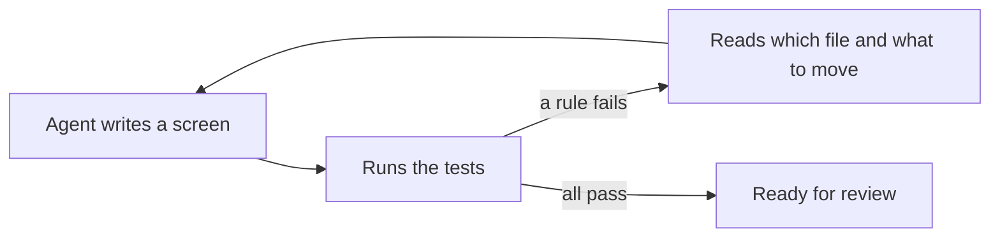

# Building with AI agents

An AI agent follows the code around it and the instructions it is given, and it checks its work by running what it can run. PulsePlatform puts the architecture where the agent already looks: in a test that fails with a message saying what to fix.

## How the loop works

The agent writes a screen, runs the tests, and reads the failures. A rule that fails names the declaration or file and says where it belongs, so the agent fixes it the same way it fixes a compile error. Nothing depends on the agent remembering a style guide, and a person reviewing the change sees code that already has the agreed shape.



## 1. Add the rules test

Add the `architecture` artifact to the tests and write one test that runs every group the project uses. Desktop apps call `assertPulseMviConventions()` and mobile apps `assertPulseMobileConventions()`. The other groups are shared.

```kotlin
class PulsePlatformConventionTest {
    @Test
    fun `follows the PulsePlatform conventions`() {
        val scope = Konsist.scopeFromProduction()
        scope.assertPulseMviConventions() // or assertPulseMobileConventions() on mobile
        scope.assertPulseDomainConventions()
        scope.assertPulseModuleConventions()
        scope.assertPulseKoinConventions()
        scope.assertPulseResourceConventions()
    }
}
```

## 2. Tell the agent about it

Agents read an instructions file at the root of the repository, such as `CLAUDE.md` or `AGENTS.md`. Say there which test holds the rules, how to run it, and that it must pass before a change is done. Pointing at this site gives the agent the reasoning behind each rule.

```markdown
## UI architecture

This app follows PulsePlatform (https://kaleidot725.github.io/PulsePlatform/).
The rules are checked by `PulsePlatformConventionTest`. Run `./gradlew test`
after every change to a screen; a change is done only when it passes. When a
rule fails, move the code where the failure message says instead of changing
the test.
```

## 3. Read a failure

A failure names the rule, says how to fix it, and lists the files or declarations that break it. This one comes from a mobile app whose root composable was named `UnboundPage`.

```
Assert 'screens are named Screen' was violated (1 time).
Name the file `…Screen`, or move the composable into `section` or `component`.
Invalid files:
└── File UnboundPage.kt file:///…/feature/unbound/UnboundPage.kt
```

## Tips

- Add the test before the code. An empty project passes, so the rules are in place from the first screen an agent writes
- Keep the test in the normal test task. An agent runs `./gradlew test`, and a rule in a separate task is a rule it never sees
- Leave a rule out rather than ignore it. Each check is public on its own, so a project that disagrees with one can [call the rest](/guide/rules/#choosing-the-rules)
- Let the library carry the shape. An agent that starts from `PulseContent` and a section with callbacks already writes what the rules ask
