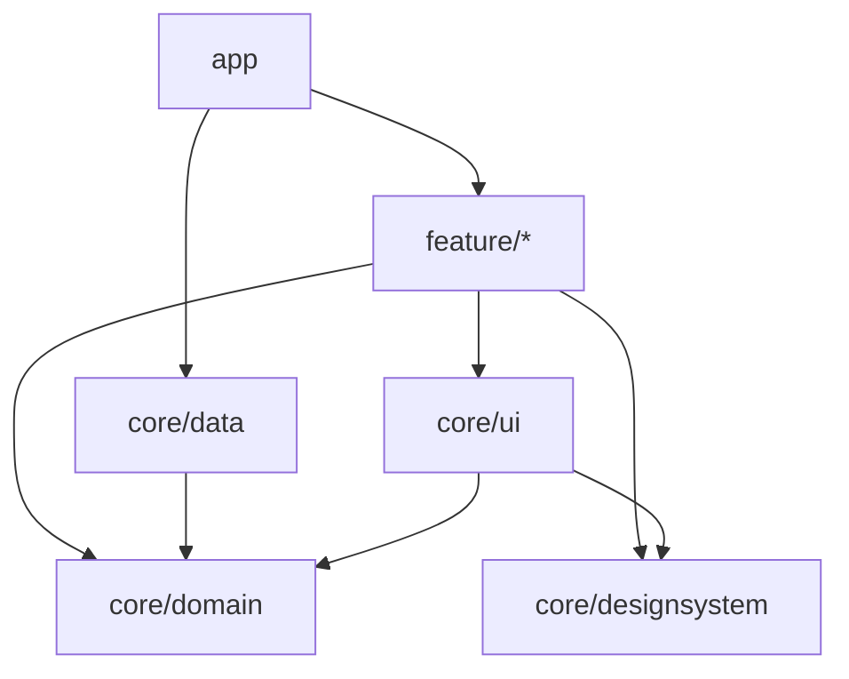

# Architecture checks

`architecture` is an optional artifact. It states the conventions PulseDesktop expects of the code around it as [Konsist](https://docs.konsist.lemonappdev.com/) assertions, so your own test suite checks them.

The compiler already rejects what the types can express. A ViewModel must implement `onAction`, and its message types must be the ones its Container knows. What is left are habits the types cannot express, each with a consequence that is easy to miss in review.

The checks come in four groups, one assertion each. Every group can be used without the others.

| Assertion | What it checks |
|---|---|
| `assertPulseMviConventions()` | the state and message types, the ViewModel and Container names, how the views are split, and that every component has a preview |
| `assertPulseDomainConventions()` | how a repository hands out its data, and what earns a use case its place |
| `assertPulseModuleConventions()` | which module may depend on which, and the packages inside the domain and the data layer |
| `assertPulseKoinConventions()` | where Koin modules are declared |

## Setup

Add the artifact to the test classpath. Konsist itself comes with it, so there is nothing else to declare.

```kotlin
// build.gradle.kts
dependencies {
    testImplementation("com.github.kaleidot725.PulseDesktop:architecture:<version>")
}
```

Then write one test. `scopeFromProduction()` reads the project's main source sets, leaving test code out.

```kotlin
class PulseDesktopConventionTest {
    @Test
    fun `follows the PulseDesktop conventions`() {
        val scope = Konsist.scopeFromProduction()
        scope.assertPulseMviConventions()
        scope.assertPulseDomainConventions()
        scope.assertPulseModuleConventions()
        scope.assertPulseKoinConventions()
    }
}
```

## Declarations

`assertPulseMviConventions()` runs eight checks: four about the declarations and four about the views. A failure names the declaration and says how to fix it.

| Check | Rule | Why |
|---|---|---|
| States are data types | a `PulseState` is a `data class` or `data object` | `StateFlow` drops an emission equal to the last one, and Compose skips a composable whose arguments are equal. Without `equals` the screen recomposes on every update |
| Messages are sealed classes | an Action, Event, Broadcast or Unicast is a `sealed class`, and each case inside it is a `data class` or `data object`; a message with one case may be a single `data class` or `data object`, and an interface is never one | each one is consumed by a `when`. Sealing is what turns a new case into a compile error instead of a branch nobody wrote, and `data` lets a case compare and print by its value |
| Names follow the base class | a `PulseViewModel` is named `…ViewModel`, a `PulseContainer` is named `…Container` | both are `ViewModel` subclasses to the compiler, so the name is what tells a reader which one this is |
| Data lives in the state | a ViewModel and a Container declare no `var` property | a `var` beside the state changes without an emission, so nothing recomposes |

## Views

A **screen** is what a route shows: it creates the ViewModels and the Container and lays the parts out. A **section** is the part one ViewModel answers for. A **component** is a leaf that takes data and callbacks.

The package decides which is which, so function names stay free. A screen sits at the root of its feature package, a section under `section`, a component under `component`. Being a component wins over the section around it, because a section's own components normally live inside it.

```
count/
├── PulseCountHost.kt          # screen
├── PulseCountContainer.kt
├── component/                 # components of the screen
│   └── PulseCountHeader.kt
├── section/
│   └── area/
│       ├── PulseAreaContent.kt    # section
│       ├── PulseAreaViewModel.kt
│       ├── component/             # components of the section
│       │   └── PulseAreaCell.kt
│       └── state/
└── state/
```

| Check | Rule | Why |
|---|---|---|
| Sections bind one ViewModel | a file with a composable under `section` calls `PulseContent` | the section is the only place the ViewModel and the UI meet. A file that binds nothing is a component in the wrong package |
| Components are stateless | a composable under `component` takes no `…ViewModel` or `…Container` parameter, and calls neither `PulseContent` nor `PulseHost` | data and callbacks are what make a component reusable between sections and previewable on its own |
| Screens compose sections | a composable outside both packages does not call `PulseContent` | binding a ViewModel in the screen instead of a section is how a screen grows into the file that knows everything |
| Components have previews | every public composable under `component` has a matching `@Preview` | a preview is all a component needs to be seen on its own, and it is the first thing that breaks when the component does |

### Preview names

A preview matches its component by name: `<Component>_Preview`, or `<Component>_Preview_<Condition>` for a particular state. One match is enough, and a component with several states can have one per condition. A preview named any other way does not count, which is how a renamed component left without its preview is caught.

| Preview | Matches `PulseTextButton` |
|---|---|
| `PulseTextButton_Preview` | yes |
| `PulseTextButton_Preview_Disabled` | yes |
| `PulseTextButton_Preview_Disabled_Dark` | yes |
| `PulseTextButtonPreview` | no |

## Repositories

`assertPulseDomainConventions()` checks how a repository hands out its data. A repository is a class or an interface whose name ends with `Repository`.

| Check | Rule | Why |
|---|---|---|
| Values to follow are flows | a public property is a cold `Flow` or a `StateFlow` | whoever reads it keeps following it. A `SharedFlow` drops what came before the collector, a public `MutableStateFlow` lets the caller write past the repository, and a plain value is stale once read |
| One-shot calls return a result | a public function that returns a value returns a `Flow`, a `StateFlow` or kotlin-result's `Result<V, E>` | a one-shot call can fail, and `Result<V, E>` puts the failure and its kinds in the type. `kotlin.Result` has no error type, so it does not count |

### What a repository may do

These are allowed and are not counted as data the repository hands out.

- A function that returns nothing is a command and is not checked
- A property holding another repository, or a function such as one a data module exposes, is what the repository uses
- A private `MutableStateFlow` behind a public `StateFlow` is how the repository changes its own state

## Use cases

A ViewModel may call a repository directly, so a use case is optional. Write one only when it has work of its own, such as combining two flows or deciding whether to act. `assertPulseDomainConventions()` checks the use cases there are. A use case is a class whose name ends with `UseCase`.

| Check | Rule | Why |
|---|---|---|
| Use cases have a package | a use case is in a `usecase` package | the entities, the repository interfaces and the use cases are read for different reasons, so each has its own place |
| Use cases do work of their own | no public function of a use case is a single line | a one-line use case only hands the call on to a repository. It is a class to read and wire for a call the ViewModel can make itself |

## Modules

`assertPulseModuleConventions()` checks a multi-module app. The modules are named after Now in Android's, and the dependencies point the way Clean Architecture asks.

### Layers

Each module belongs to one layer. A module outside these names is not checked.

| Module | Layer |
|---|---|
| `app` | the application, which wires everything together |
| `feature/<name>` | one feature's screens, sections and ViewModels; `feature/<name>/api` and `/impl` count as one feature |
| `core/domain` | the entities, the repository interfaces, and the use cases when there are any |
| `core/data` | the repository implementations and the data sources they read |
| `core/designsystem` | the theme and the building blocks every screen is drawn with |
| `core/ui` | composables shared between features that draw the domain's entities |
| any other `core/<name>` | support, such as `core/common` or `core/testing` |

### Direction

The domain is the centre and depends on nothing. Unlike Now in Android, where the domain module depends on the data module, the domain owns the repository interfaces and `core/data` implements them. A feature reaches data only through the domain, and the app hands it the implementation.

The design system depends on nothing either. Its building blocks take text, numbers and callbacks, so any screen can use them whatever it shows. A composable that takes an entity belongs in `core/ui`, which may use both the domain and the design system.



### Rules

Dependencies are read from the imports in each file, so what is checked is the code that is actually used.

| Check | Rule |
|---|---|
| Nothing depends on the app | no module imports from the app |
| Features are independent | a feature imports from no other feature |
| The core never depends on features | no core module imports from a feature |
| The domain depends on nothing | the domain imports only from support modules |
| The data layer implements the domain | the data layer imports only from the domain and support |
| The design system stands alone | the design system imports only from support |
| Shared UI only draws | the shared UI imports only from the domain, the design system, itself and support |
| Features reach data through the domain | a feature imports nothing from the data layer |
| The domain is framework-free | the domain imports nothing from Compose, AndroidX Lifecycle or PulseDesktop |

### Packages

Inside the domain and the data layer, the package says what a declaration is. A file sits in one of these packages, and any part of its package name may be the one: `com.example.core.domain.model` and `com.example.core.domain.model.area` both count as `model`.

A data source in `local` only persists: it reads, writes and removes what it is given. How a value changes — adding one to a count, deciding what a missing value means — is the repository's.

The table lists the packages of each layer, and a typical layout follows it.

| Layer | Packages |
|---|---|
| domain | `model` for the entities, `repository` for the repository interfaces, `usecase` for the use cases |
| data | `repository` for the repository implementations, `local` for the data sources, `model` for what those sources store |

```
core/domain/…/domain/
├── model/          # PulseArea
├── repository/     # PulseCountRepository
└── usecase/        # ReceivePulseUseCase
core/data/…/data/
├── local/          # PulseCountLocalDataSource
├── model/          # what the data source stores, when it differs from the entity
└── repository/     # DataStorePulseCountRepository
```

### Other module names

The names are a `PulseModuleLayout`. Each layer is a list of path patterns matched against the end of a module's directory, with `*` standing for one directory. Layers are tried in order, so a broad `support` pattern only takes what the others left. Every module assertion, and the Koin one, takes a layout.

```kotlin
val layout =
    PulseModuleLayout(
        app = listOf("desktop"),
        features = listOf("features/*"),
        domain = listOf("shared/domain"),
        data = listOf("shared/data"),
        sharedUi = listOf("shared/widget"),
        support = listOf("shared/*"),
        designSystem = listOf("shared/theme"),
    )

Konsist.scopeFromProduction().assertPulseModuleConventions(layout)
```

## Koin

`assertPulseKoinConventions()` is for an app that uses Koin, and a project without Koin passes. Only declaring a Koin module is restricted: resolving from Koin with `koinInject`, `getKoin` or `parametersOf` is allowed anywhere. The check takes the same `PulseModuleLayout` as the module checks.

| Check | Rule | Why |
|---|---|---|
| Koin modules live in the app | a file that declares a Koin module — with `org.koin.dsl.module` or Koin Annotations' `@Module` — is in the app module | the app is the one module that knows every other, so it is the one place the whole graph can be read. A feature or core module with its own Koin module takes part of that decision away |

## Choosing the checks

Each check is public on its own. A project that disagrees with one can run the others.

```kotlin
@Test
fun `follows the conventions we agreed on`() {
    val scope = Konsist.scopeFromProduction()
    scope.assertStatesAreDataTypes()
    scope.assertMessagesAreSealedOrDataTypes()
    scope.assertViewModelsHoldTheirDataInTheirState()
}
```

## Writing your own rules

The queries behind the checks are public too, so a project can add rules of its own on top of them. `pulseViewModels()`, `pulseContainers()`, `pulseStateClasses()`, `pulseStateObjects()`, `pulseMessageInterfaces()`, `pulseMessageClasses()` and `pulseMessageObjects()` return the declarations that extend or implement the matching type. `pulseScreens()`, `pulseSections()` and `pulseComponents()` return the files that hold composables of each role. `pulseRepositoryClasses()`, `pulseRepositoryInterfaces()` and `pulseRepositories()` return the repositories, `pulseKoinModuleFiles()` the files that declare Koin modules, and `pulseModule(layout)` names the module a file belongs to.

```kotlin
@Test
fun `every ViewModel lives in a feature package`() {
    Konsist
        .scopeFromProduction()
        .pulseViewModels()
        .assertTrue { it.resideInPackage("..feature..") }
}
```

## What it cannot do

Konsist has no plugin mechanism, unlike ktlint's rule sets or detekt's plugins. The artifact cannot install itself, which is why your project writes the test that calls it.

Konsist also reads source code rather than compiled classes. A ViewModel that reaches `PulseViewModel` through a base class from a library is not recognised, because that base class is not in the sources being scanned.

Konsist does not read Gradle build scripts either, so the module checks find dependencies through imports. A dependency that is declared in a build script but never imported is not seen.

An empty result passes. A module with no PulseDesktop types yet does not fail, so the test can be added before the code it checks.

## Next steps

- [Architecture checks API](/api/architecture) — the signature of every assertion and query
- [Architecture](/guide/architecture) — the conventions these checks come from
- [ViewModel](/guide/viewmodel) — state, actions and the lifecycle hooks
