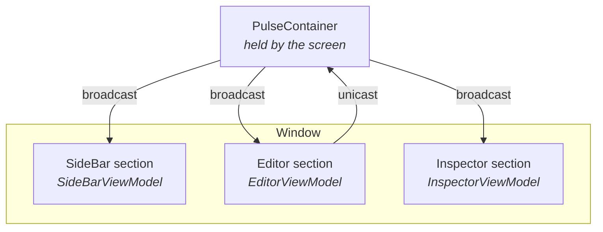

# What is PulseDesktop?

PulseDesktop is a framework for building **Compose Desktop** apps. It decides how a window is split, where each part keeps its state, how the parts talk to each other and how long they live. Your own tests can check that the code keeps to those decisions.

## Why a desktop framework

On a phone, one screen usually maps to one ViewModel. A desktop window is different: a sidebar, an editor and an inspector are on screen together. Each changes on its own, and some of those changes have to reach the others.

Putting all of it in one ViewModel turns that ViewModel into the file that knows everything. Splitting it with no way to coordinate makes the panels reach into each other instead. PulseDesktop gives each part its own ViewModel and puts one Container above them.

## How a window is split

A window is built from three kinds of composable. The package a composable lives in decides which one it is.

| Role | What it does | Where it lives |
|---|---|---|
| **Screen** | What a route shows. It creates the ViewModels and the Container, and lays out the sections | the root of a feature package |
| **Section** | The part one ViewModel answers for. It binds that ViewModel with `PulseContent` | a `section` package |
| **Component** | A leaf. It takes data and callbacks, so it can be reused and previewed on its own | a `component` package |

## How the sections work together

The Container held by the screen is what connects the sections. Three features carry the messages between them.

| Feature | Description |
|---|---|
| **Broadcast** | Deliver a typed message from the Container to every section's ViewModel at once |
| **Unicast** | Send a typed message from one section's ViewModel up to the Container |
| **View Refresh** | Rebuild the view tree under the Container without losing any ViewModel's state |

## An example window

In the window below, the editor reports a change with Unicast, and the Container broadcasts it to all three sections. Each section decides on its own how to react.



## Artifacts

PulseDesktop is split into three artifacts, one package each. Only `mvi` is required.

| Artifact | What it decides | Contents |
|---|---|---|
| `mvi` | where state lives and how sections talk | `PulseViewModel`, `PulseContainer`, `PulseHost`, `PulseContent` and the five marker interfaces |
| `navigation` | how long a screen's ViewModels live | `rememberPulseViewModel`, `rememberPulseContainer`, `rememberPulseNavEntryDecorators` |
| `architecture` | that the code keeps to the conventions | Konsist assertions for the state rules, the screen, section and component split, component previews, repositories, module dependencies and Koin |

## Installation

### Repository

Add JitPack to `settings.gradle.kts`.

```kotlin
// settings.gradle.kts
dependencyResolutionManagement {
    repositories {
        maven { url = uri("https://jitpack.io") }
    }
}
```

### Dependencies

Add the dependencies to `build.gradle.kts`. Replace `<version>` with the latest tag from [GitHub Releases](https://github.com/kaleidot725/PulseDesktop/releases).

```kotlin
// build.gradle.kts
dependencies {
    implementation("com.github.kaleidot725.PulseDesktop:mvi:<version>")

    // Optional: scope ViewModels to a Navigation 3 back stack entry
    implementation("com.github.kaleidot725.PulseDesktop:navigation:<version>")

    // Optional: check the conventions in your tests
    testImplementation("com.github.kaleidot725.PulseDesktop:architecture:<version>")
}
```

## Requirements

| Requirement | Version |
|---|---|
| Java | 17+ |
| Kotlin | 2.0+ |
| Compose Multiplatform | 1.6+ |

## Next Steps

- [Getting Started](/guide/getting-started) — build your first counter app
- [Architecture](/guide/architecture) — understand how state flows
- [Container](/guide/container) — make the sections work together
- [Navigation 3](/guide/navigation3) — scope ViewModels to a back stack entry
- [Architecture checks](/guide/architecture-checks) — check in your tests that the code follows the conventions
