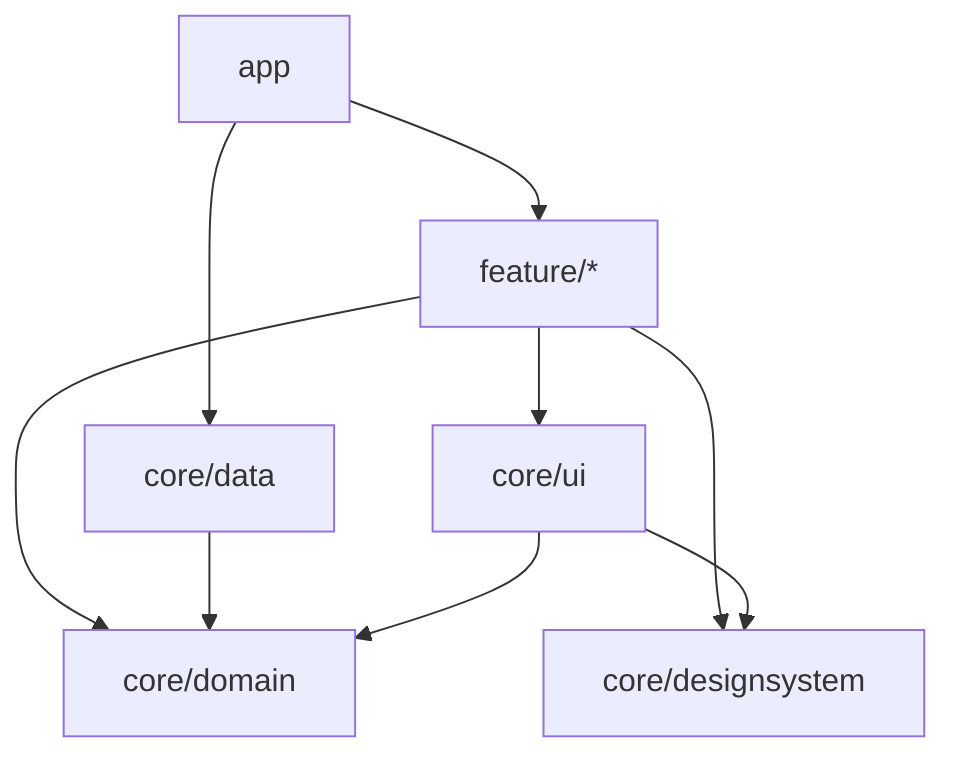

# Modules and Koin

These rules keep a multi-module app's dependencies pointing one way, and its wiring in one place. They read the imports of every file, on the desktop and on mobile alike.

`assertPulseModuleConventions()` checks a multi-module app. The modules are named after Now in Android's, and the dependencies point the way Clean Architecture asks.

## Layers

Each module belongs to one layer. A module outside these names is not checked.

| Module | Layer |
|---|---|
| `app` | the application, which wires everything together |
| `feature/<name>` | one feature's host, contents, sections, components and ViewModels; `feature/<name>/api` and `/impl` count as one feature |
| `core/domain` | the entities, the repository interfaces, and the use cases when there are any |
| `core/data` | the repository implementations and the data sources they read |
| `core/designsystem` | the theme and the building blocks every screen is drawn with |
| `core/ui` | composables shared between features that draw the domain's entities |
| any other `core/<name>` | support, such as `core/common` or `core/testing` |

## Direction

The domain is the centre and depends on nothing. Unlike Now in Android, where the domain module depends on the data module, the domain owns the repository interfaces and `core/data` implements them. A feature reaches data only through the domain, and the app hands it the implementation.

The design system depends on nothing either. Its building blocks take text, numbers and callbacks, so any screen can use them whatever it shows. A composable that takes an entity belongs in `core/ui`, which may use both the domain and the design system.



## Rules

Dependencies are read from the imports in each file, so what is checked is the code that is actually used.

| Check | Rule |
|---|---|
| Nothing depends on the app | no module imports from the app |
| Features are independent | a feature imports from no other feature |
| The core never depends on features | no core module imports from a feature |
| The domain depends on nothing | the domain imports only from support modules |
| The data layer implements the domain | the data layer imports only from the domain and support |
| The design system stands alone | the design system imports only from support |
| Shared UI only draws | the shared UI imports only from the domain, the design system, itself and support |
| Features reach data through the domain | a feature imports nothing from the data layer |
| The domain is framework-free | the domain imports nothing from Compose, AndroidX Lifecycle or PulsePlatform |
| The design system is split by kind | every file of the design system is in a package named after its kind |

## Packages

Inside the domain and the data layer, the package says what a declaration is. A file sits in one of these packages, and any part of its package name may be the one: `com.example.core.domain.model` and `com.example.core.domain.model.area` both count as `model`.

A data source in `local` only persists: it reads, writes and removes what it is given. How a value changes — adding one to a count, deciding what a missing value means — is the repository's.

The design system is split by kind instead. Everything in it is a building block, so a package called `component` says nothing about what is inside it; a package per kind tells a reader where a button is. The root is the package named after the module's directory, `designsystem` for `core/designsystem`, and no file sits directly in it.

The table lists the packages of each layer, and a typical layout follows it.

| Layer | Packages |
|---|---|
| domain | `model` for the entities, `repository` for the repository interfaces, `usecase` for the use cases |
| data | `repository` for the repository implementations, `local` for the data sources, `model` for what those sources store |
| design system | one package per kind, such as `button`, `card` or `theme`; never a catch-all such as `component`, `components`, `widget`, `widgets`, `composable`, `composables` or `common` |

```
core/domain/…/domain/
├── model/          # PulseArea
├── repository/     # PulseCountRepository
└── usecase/        # ReceivePulseUseCase
core/data/…/data/
├── local/          # PulseCountLocalDataSource
├── model/          # what the data source stores, when it differs from the entity
└── repository/     # DataStorePulseCountRepository
core/designsystem/…/designsystem/
├── button/         # PulseButton, PulseTextButton
├── card/           # PulseCard
└── theme/          # PulsePlatformTheme
```

## Other module names

The names are a `PulseModuleLayout`. Each layer is a list of path patterns matched against the end of a module's directory, with `*` standing for one directory. Layers are tried in order, so a broad `support` pattern only takes what the others left. Every module assertion, and the Koin one, takes a layout.

```kotlin
val layout =
    PulseModuleLayout(
        app = listOf("desktop"),
        features = listOf("features/*"),
        domain = listOf("shared/domain"),
        data = listOf("shared/data"),
        sharedUi = listOf("shared/widget"),
        support = listOf("shared/*"),
        designSystem = listOf("shared/theme"),
    )

Konsist.scopeFromProduction().assertPulseModuleConventions(layout)
```

## Koin

`assertPulseKoinConventions()` is for an app that uses Koin, and a project without Koin passes. Only declaring a Koin module is restricted: resolving from Koin with `koinInject`, `getKoin` or `parametersOf` is allowed anywhere. The check takes the same `PulseModuleLayout` as the module checks.

| Check | Rule | Why |
|---|---|---|
| Koin modules live in the app | a file that declares a Koin module — with `org.koin.dsl.module` or Koin Annotations' `@Module` — is in the app module | the app is the one module that knows every other, so it is the one place the whole graph can be read. A feature or core module with its own Koin module takes part of that decision away |

## Next steps

- [Text](/guide/rules/text) — where the text a user reads comes from
