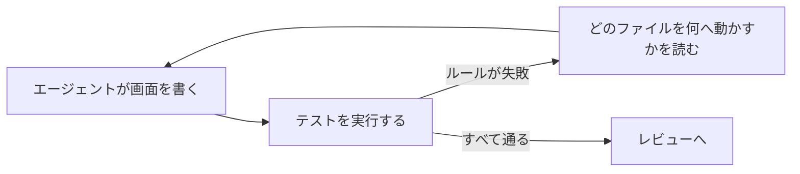

# AI エージェントと作る

AI エージェントは、まわりのコードと与えられた指示に従い、実行できるものを実行して作業を確かめます。PulsePlatform は、アーキテクチャをエージェントがすでに見ている場所、つまり何を直すかを示して失敗するテストに置きます。

## ループの流れ

エージェントは画面を書き、テストを実行し、失敗を読みます。失敗したルールは宣言やファイルの名前と、それがどこにあるべきかを示すので、エージェントはコンパイルエラーと同じように直せます。スタイルガイドを覚えておくことに頼らず、変更をレビューする人も、最初から決めた形になったコードを見ることになります。



## 1. ルールのテストを追加する

テストに `architecture` アーティファクトを追加し、プロジェクトで使うグループをすべて実行するテストを 1 本書きます。デスクトップのアプリは `assertPulseMviConventions()`、モバイルのアプリは `assertPulseMobileConventions()` を呼びます。ほかのグループは共通です。

```kotlin
class PulsePlatformConventionTest {
    @Test
    fun `follows the PulsePlatform conventions`() {
        val scope = Konsist.scopeFromProduction()
        scope.assertPulseMviConventions() // モバイルでは assertPulseMobileConventions()
        scope.assertPulseDomainConventions()
        scope.assertPulseModuleConventions()
        scope.assertPulseKoinConventions()
        scope.assertPulseResourceConventions()
    }
}
```

## 2. エージェントに伝える

エージェントは、`CLAUDE.md` や `AGENTS.md` のような、リポジトリのルートにある指示ファイルを読みます。そこに、ルールがどのテストにあるか、どう実行するか、変更を終える前に通さなければならないことを書きます。このサイトを示しておけば、エージェントは各ルールの理由も読めます。

```markdown
## UI のアーキテクチャ

このアプリは PulsePlatform（https://kaleidot725.github.io/PulsePlatform/）に従います。
ルールは `PulsePlatformConventionTest` が検査します。画面を変更したら毎回
`./gradlew test` を実行し、通ったときだけ変更を終えてください。ルールが
失敗したら、テストを変えるのではなく、失敗メッセージのとおりにコードを動かしてください。
```

## 3. 失敗を読む

失敗は、ルールの名前と直し方、違反しているファイルや宣言を示します。次の例は、ルートの Composable を `UnboundPage` と名付けたモバイルアプリのものです。

```
Assert 'screens are named Screen' was violated (1 time).
Name the file `…Screen`, or move the composable into `section` or `component`.
Invalid files:
└── File UnboundPage.kt file:///…/feature/unbound/UnboundPage.kt
```

## ヒント

- テストはコードより先に追加します。空のプロジェクトは通るので、エージェントが最初の画面を書くときからルールが効きます
- テストは通常のテストタスクに入れておきます。エージェントが実行するのは `./gradlew test` で、別のタスクにあるルールはエージェントの目に入りません
- 無視するくらいなら、そのルールを外します。各検査は単独でも公開しているので、合わないものがあれば [残りを呼べます](/ja/guide/rules/#ルールを選ぶ)
- 形はライブラリに任せます。`PulseContent` とコールバックを受け取る Section から始めれば、エージェントは最初からルールが求めるものを書きます
