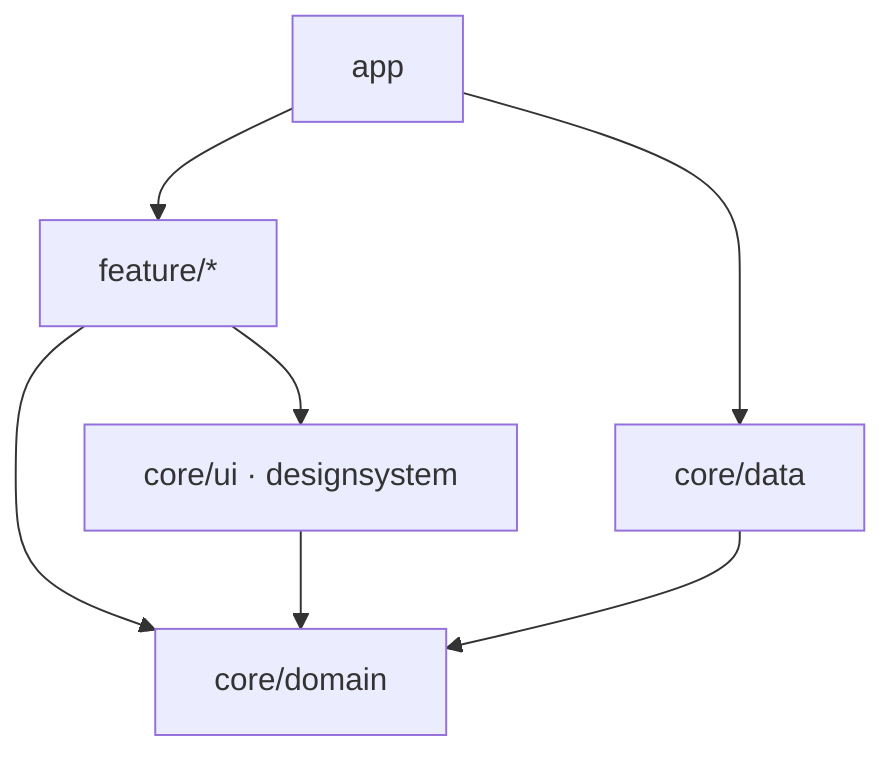

# アーキテクチャ検査

`architecture` は任意のアーティファクトです。PulseDesktop が周りのコードに期待する規約を [Konsist](https://docs.konsist.lemonappdev.com/) のアサートとして公開しているので、自分のテストで検査できます。

型で表せることはコンパイラが弾きます。ViewModel は `onAction` を実装しなければならず、メッセージの型は Container が知っているものに限られます。残るのは型で表せない書き方の習慣で、どれもレビューで見落としやすいものです。

検査は 4 つのグループに分かれていて、グループごとにアサートが 1 つあります。どのグループも単独で使えます。

| アサート | 検査する内容 |
|---|---|
| `assertPulseMviConventions()` | State とメッセージの型、ViewModel と Container の名前、View の分け方、すべての Component に Preview があること |
| `assertPulseDomainConventions()` | Repository がデータをどう公開するか |
| `assertPulseModuleConventions()` | どのモジュールがどのモジュールに依存してよいか |
| `assertPulseKoinConventions()` | Koin のモジュールをどこで定義するか |

## セットアップ

テストの依存に追加します。Konsist 自体も一緒に入るので、ほかに宣言するものはありません。

```kotlin
// build.gradle.kts
dependencies {
    testImplementation("com.github.kaleidot725.PulseDesktop:architecture:<version>")
}
```

あとはテストを 1 本書きます。`scopeFromProduction()` はプロダクションのソースセットだけを読み、テストコードを除きます。

```kotlin
class PulseDesktopConventionTest {
    @Test
    fun `follows the PulseDesktop conventions`() {
        val scope = Konsist.scopeFromProduction()
        scope.assertPulseMviConventions()
        scope.assertPulseDomainConventions()
        scope.assertPulseModuleConventions()
        scope.assertPulseKoinConventions()
    }
}
```

## 宣言

`assertPulseMviConventions()` は 8 つの検査を実行します。4 つは宣言について、4 つは View についてのものです。失敗したときは、該当する宣言の名前と直し方を出します。

| 検査 | ルール | 理由 |
|---|---|---|
| State は data 型 | `PulseState` は `data class` または `data object` | `StateFlow` は直前と等しい値を流さず、Compose は引数が等しい Composable をスキップする。`equals` がないと更新ごとに画面全体が再コンポジションされる |
| メッセージは sealed class | Action・Event・Broadcast・Unicast は `sealed class`、その中の各ケースは `data class` か `data object` | どれも `when` で処理される。sealed にしてあればケースの追加がコンパイルエラーになり、`data` にしてあればケースが値で比較・表示される |
| 名前は基底クラスに従う | `PulseViewModel` は `…ViewModel`、`PulseContainer` は `…Container` | コンパイラにとってはどちらも `ViewModel` のサブクラスなので、どちらなのかを示すのは名前だけ |
| データは State に置く | ViewModel と Container は `var` プロパティを持たない | State の外の `var` は変更しても emission が起きず、何も再コンポジションされない |

## View

**Screen** はルートが表示するもので、ViewModel と Container を生成し、各パーツを配置します。**Section** は 1 つの ViewModel が受け持つ部分です。**Component** は末端で、データとコールバックだけを受け取ります。

どれに当たるかを決めるのはパッケージなので、関数名は自由です。Screen は feature パッケージのルート、Section は `section` 配下、Component は `component` 配下に置きます。Section の内側にある `component` は Component として扱われます。Section 専用の Component は、その Section の中に置くのが自然だからです。

```
count/
├── PulseCountHost.kt          # Screen
├── PulseCountContainer.kt
├── component/                 # Screen の Component
│   └── PulseCountHeader.kt
├── section/
│   └── area/
│       ├── PulseAreaContent.kt    # Section
│       ├── PulseAreaViewModel.kt
│       ├── component/             # Section の Component
│       │   └── PulseAreaCell.kt
│       └── state/
└── state/
```

| 検査 | ルール | 理由 |
|---|---|---|
| Section は ViewModel を 1 つ束ねる | `section` 配下の Composable を持つファイルは `PulseContent` を呼ぶ | ViewModel と UI が出会うのは Section だけ。何も束ねていないファイルは、置き場所を間違えた Component |
| Component は stateless | `component` 配下の Composable は `…ViewModel` や `…Container` を引数に取らず、`PulseContent` も `PulseHost` も呼ばない | データとコールバックだけで済むから、ほかの Section でも使え、単体で Preview できる |
| Screen は Section を並べる | どちらのパッケージにも属さない Composable は `PulseContent` を呼ばない | Section ではなく Screen で束ねると、Screen がすべてを知るファイルに育つ |
| Component には Preview がある | `component` 配下の public な Composable には、対応する `@Preview` がある | Component は Preview があれば単体で確認でき、Component が壊れたときに最初に気づける |

### Preview の名前

Preview は名前で Component と対応付けます。`<Component>_Preview`、または特定の状態を示す `<Component>_Preview_<条件>` です。1 つあれば十分で、状態がいくつもある Component は条件ごとに置けます。それ以外の名前の Preview は数えないので、Component だけリネームして Preview が古い名前のまま残った場合も検出できます。

| Preview | `PulseTextButton` に対応するか |
|---|---|
| `PulseTextButton_Preview` | する |
| `PulseTextButton_Preview_Disabled` | する |
| `PulseTextButton_Preview_Disabled_Dark` | する |
| `PulseTextButtonPreview` | しない |

## Repository

`assertPulseDomainConventions()` は、Repository がデータをどう公開するかを検査します。Repository は、名前が `Repository` で終わる class または interface です。

| 検査 | ルール | 理由 |
|---|---|---|
| 購読する値は Flow で公開する | public プロパティはコールド `Flow` または `StateFlow` | 読む側はその値を購読し続ける。`SharedFlow` は購読前の値を落とし、public な `MutableStateFlow` は呼び出し側に書き換えさせ、ただの値は読んだ時点で古くなる |
| ワンショットの取得は Result で返す | 値を返す public 関数は `Flow`、`StateFlow`、または kotlin-result の `Result<V, E>` を返す | ワンショットの呼び出しは失敗しうる。`Result<V, E>` なら失敗とその種類が型に現れる。エラーの型を持たない `kotlin.Result` は対象外 |

### Repository に許されていること

次のものは許可されていて、Repository が公開するデータとしては数えません。

- 値を返さない関数はコマンドとして扱い、検査しない
- 別の Repository や、Data モジュールが公開する関数などを保持するプロパティは、Repository が使うもの
- public な `StateFlow` の裏にある private な `MutableStateFlow` は、Repository が自分の状態を変えるためのもの

## モジュール

`assertPulseModuleConventions()` はマルチモジュールのアプリを検査します。モジュール名は Now in Android にならい、依存の向きは Clean Architecture に従います。

### 層

各モジュールはどれか 1 つの層に属します。ここに挙げた名前以外のモジュールは検査しません。

| モジュール | 層 |
|---|---|
| `app` | すべてをつなぐアプリ本体 |
| `feature/<name>` | 1 つの機能の Screen・Section・ViewModel。`feature/<name>/api` と `/impl` は 1 つの feature として扱う |
| `core/domain` | エンティティ、ユースケース、ユースケースが使う Repository の interface |
| `core/data` | Repository の実装。データの保存先も含む |
| `core/designsystem`、`core/ui` | feature 間で共有する Composable |
| その他の `core/<name>` | `core/common` や `core/testing` などの補助 |

### 依存の向き

domain が中心で、どこにも依存しません。Now in Android では domain モジュールが data モジュールに依存しますが、ここでは domain が Repository の interface を持ち、`core/data` がそれを実装します。feature は domain を通してだけデータに触れ、実装は app が渡します。



### ルール

依存は各ファイルの import から読み取るので、検査するのは実際に使われているコードです。

| 検査 | ルール |
|---|---|
| app に依存しない | どのモジュールも app から import しない |
| feature は独立している | feature はほかの feature から import しない |
| core は feature に依存しない | core のモジュールは feature から import しない |
| domain は何にも依存しない | domain は補助モジュールからだけ import する |
| data は domain を実装する | data は domain と補助モジュールからだけ import する |
| 共有 UI は描くだけ | 共有 UI は domain、自身、補助モジュールからだけ import する |
| feature は domain 経由でデータに触れる | feature は data から何も import しない |
| domain はフレームワークに依存しない | domain は Compose、AndroidX Lifecycle、PulseDesktop から import しない |

### 別のモジュール名

モジュール名は `PulseModuleLayout` で決まります。層ごとにパスのパターンを並べ、モジュールのディレクトリの末尾と照合します。`*` は 1 階層を表します。層は順に判定するので、`support` の広いパターンは、ほかの層が取らなかったモジュールだけを拾います。モジュールの検査と Koin の検査は、すべてレイアウトを受け取ります。

```kotlin
val layout =
    PulseModuleLayout(
        app = listOf("desktop"),
        features = listOf("features/*"),
        domain = listOf("shared/domain"),
        data = listOf("shared/data"),
        sharedUi = listOf("shared/widget"),
        support = listOf("shared/*"),
    )

Konsist.scopeFromProduction().assertPulseModuleConventions(layout)
```

## Koin

`assertPulseKoinConventions()` は Koin を使うアプリのためのもので、Koin を使っていないプロジェクトは通ります。制限するのは Koin モジュールの定義だけで、`koinInject`、`getKoin`、`parametersOf` による取得はどこでも構いません。モジュールの検査と同じ `PulseModuleLayout` を使います。

| 検査 | ルール | 理由 |
|---|---|---|
| Koin モジュールは app に置く | Koin モジュールを定義するファイル（`org.koin.dsl.module` か Koin Annotations の `@Module` を使うもの）は app モジュールにある | app はほかのすべてを知る唯一のモジュールなので、依存の全体を 1 か所で読める。feature や core が自分で Koin モジュールを持つと、その判断の一部を app から奪う |

## 検査を選ぶ

それぞれの検査は単体でも公開しています。合わない検査があるプロジェクトは、ほかの検査だけを実行できます。

```kotlin
@Test
fun `follows the conventions we agreed on`() {
    val scope = Konsist.scopeFromProduction()
    scope.assertStatesAreDataTypes()
    scope.assertMessagesAreSealedOrDataTypes()
    scope.assertViewModelsHoldTheirDataInTheirState()
}
```

## 自分のルールを書く

検査の土台になっているクエリも公開しているので、その上に独自のルールを足せます。`pulseViewModels()`、`pulseContainers()`、`pulseStateClasses()`、`pulseStateObjects()`、`pulseMessageInterfaces()`、`pulseMessageClasses()`、`pulseMessageObjects()` は、対応する型を継承・実装している宣言を返します。`pulseScreens()`、`pulseSections()`、`pulseComponents()` は各役割の Composable を持つファイルを返します。`pulseRepositoryClasses()`、`pulseRepositoryInterfaces()`、`pulseRepositories()` は Repository を、`pulseKoinModuleFiles()` は Koin モジュールを定義するファイルを返し、`pulseModule(layout)` はファイルが属するモジュールの名前を返します。

```kotlin
@Test
fun `every ViewModel lives in a feature package`() {
    Konsist
        .scopeFromProduction()
        .pulseViewModels()
        .assertTrue { it.resideInPackage("..feature..") }
}
```

## できないこと

Konsist には ktlint のルールセットや detekt のプラグインのような読み込みの仕組みがありません。アーティファクト自身が勝手に走ることはできないので、呼び出すテストはプロジェクト側で書くことになります。

Konsist が読むのはコンパイル済みのクラスではなくソースコードです。ライブラリ側の基底クラスを経由して `PulseViewModel` に到達する ViewModel は、その基底クラスが走査対象のソースにないため認識できません。

Konsist は Gradle の build script も読まないので、モジュールの検査は import から依存を見つけます。build script で宣言していても、一度も import していない依存は見えません。

対象が 0 件のときは成功します。PulseDesktop の型がまだないモジュールでも落ちないので、検査するコードより先にテストを置けます。

## 次のステップ

- [アーキテクチャ検査 API](/ja/api/architecture) — アサートとクエリの完全なシグネチャ
- [アーキテクチャ](/ja/guide/architecture) — これらの検査が由来する規約
- [ViewModel](/ja/guide/viewmodel) — State、Action、ライフサイクルフック
