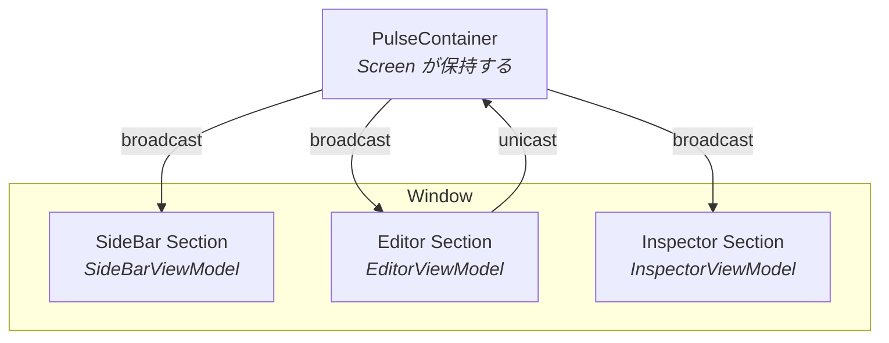

# PulseDesktop とは

PulseDesktop は **Compose Desktop** のアプリを作るためのフレームワークです。ウィンドウをどう分けるか、各部分の状態をどこに置くか、部分どうしがどうやり取りするか、それぞれがどれだけ生きるかを決めています。コードがその決まりを守っているかは、自分のテストで検査できます。

## なぜデスクトップ向けなのか

スマートフォンでは、1 つの画面に 1 つの ViewModel を対応させるのが普通です。デスクトップのウィンドウは違います。サイドバー、エディタ、インスペクタが同時に表示され、それぞれが別々に変化し、その変化の一部はほかのパネルにも届く必要があります。

すべてを 1 つの ViewModel に入れると、その ViewModel がすべてを知るファイルになります。かといって連携の手段なしに分けると、パネルどうしが互いの中身に手を伸ばし始めます。PulseDesktop は各部分に専用の ViewModel を持たせ、その上に Container を 1 つ置きます。

## ウィンドウの分け方

ウィンドウは 3 種類の Composable から組み立てます。どれに当たるかは、Composable を置くパッケージで決まります。

| 役割 | 何をするか | 置き場所 |
|---|---|---|
| **Screen** | ルートが表示するもの。ViewModel と Container を生成し、Section を配置する | feature パッケージのルート |
| **Section** | 1 つの ViewModel が受け持つ部分。その ViewModel を `PulseContent` で束ねる | `section` パッケージ |
| **Component** | 末端。データとコールバックだけを受け取るので、使い回せて単体で Preview できる | `component` パッケージ |

## Section どうしの連携

Section をつなぐのは、Screen が持つ Container です。Section 間のメッセージは 3 つの機能が運びます。

| 機能 | 説明 |
|---|---|
| **Broadcast** | Container から、すべての Section の ViewModel へ型付きメッセージを一度に届ける |
| **Unicast** | ある Section の ViewModel から、Container へ型付きメッセージを送る |
| **View Refresh** | どの ViewModel の状態も失わずに、Container 配下のビューツリーを作り直す |

## ウィンドウの例

下のウィンドウでは、エディタが変更を Unicast で伝え、Container がそれを 3 つの Section すべてに Broadcast します。どう反応するかは、それぞれの Section が自分で決めます。



## アーティファクト

PulseDesktop は 3 つのアーティファクトに分かれていて、それぞれが 1 つのパッケージを持ちます。必須なのは `mvi` だけです。

| アーティファクト | 何を決めるか | 内容 |
|---|---|---|
| `mvi` | 状態をどこに置き、Section どうしがどうやり取りするか | `PulseViewModel`、`PulseContainer`、`PulseHost`、`PulseContent`、5 つのマーカーインターフェース |
| `navigation` | Screen の ViewModel がどれだけ生きるか | `rememberPulseViewModel`、`rememberPulseContainer`、`rememberPulseNavEntryDecorators` |
| `architecture` | コードが規約を守っているか | 状態の規約、Screen・Section・Component の分け方、Component の Preview、Repository、モジュール間の依存、Koin を検査する Konsist のアサート |

## インストール

### リポジトリ

`settings.gradle.kts` に JitPack を追加します。

```kotlin
// settings.gradle.kts
dependencyResolutionManagement {
    repositories {
        maven { url = uri("https://jitpack.io") }
    }
}
```

### 依存関係

`build.gradle.kts` に依存を追加します。`<version>` は [GitHub Releases](https://github.com/kaleidot725/PulseDesktop/releases) の最新タグに置き換えてください。

```kotlin
// build.gradle.kts
dependencies {
    implementation("com.github.kaleidot725.PulseDesktop:mvi:<version>")

    // 任意: ViewModel を Navigation 3 のバックスタックエントリにスコープする
    implementation("com.github.kaleidot725.PulseDesktop:navigation:<version>")

    // 任意: 規約をテストで検査する
    testImplementation("com.github.kaleidot725.PulseDesktop:architecture:<version>")
}
```

## 要件

| 要件 | バージョン |
|---|---|
| Java | 17 以上 |
| Kotlin | 2.0 以上 |
| Compose Multiplatform | 1.6 以上 |

## 次のステップ

- [はじめかた](/ja/guide/getting-started) — 最初のカウンターアプリを作る
- [アーキテクチャ](/ja/guide/architecture) — 状態がどう流れるかを理解する
- [Container](/ja/guide/container) — Section をまとめて動かす
- [Navigation 3](/ja/guide/navigation3) — ViewModel をバックスタックエントリにスコープする
- [アーキテクチャ検査](/ja/guide/architecture-checks) — 規約に従っているかを自分のテストで検査する
