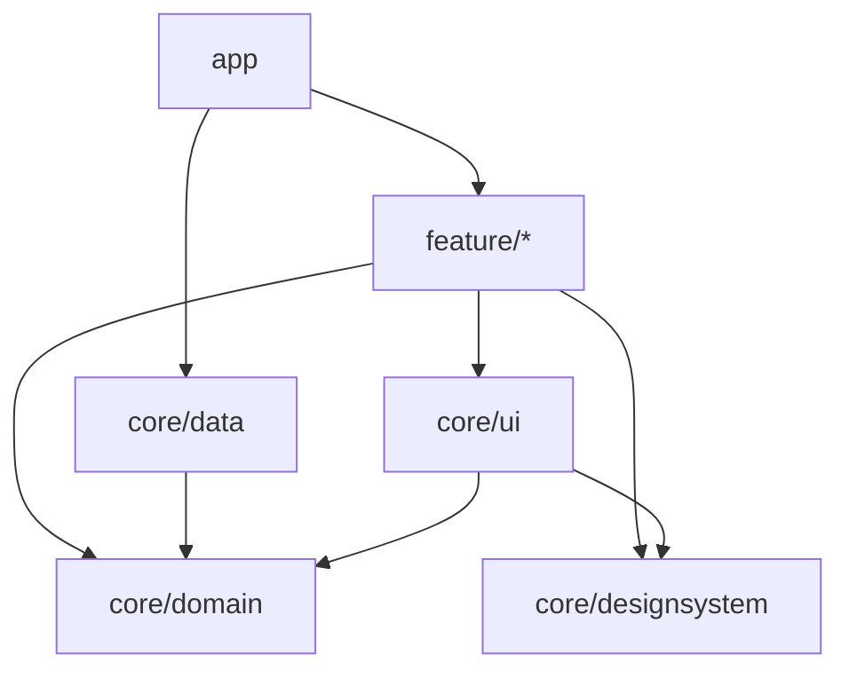

# モジュールと Koin

これらのルールは、マルチモジュールのアプリの依存を一方向に保ち、組み立てを 1 か所にまとめます。すべてのファイルの import を読むので、デスクトップでもモバイルでも同じです。

`assertPulseModuleConventions()` はマルチモジュールのアプリを検査します。モジュール名は Now in Android にならい、依存の向きは Clean Architecture に従います。

## 層

各モジュールはどれか 1 つの層に属します。ここに挙げた名前以外のモジュールは検査しません。

| モジュール | 層 |
|---|---|
| `app` | すべてをつなぐアプリ本体 |
| `feature/<name>` | 1 つの機能の Host・Content・Section・Component・ViewModel。`feature/<name>/api` と `/impl` は 1 つの feature として扱う |
| `core/domain` | エンティティ、Repository の interface、UseCase（作る場合） |
| `core/data` | Repository の実装と、それが読む DataSource |
| `core/designsystem` | テーマと、すべての画面で使う部品 |
| `core/ui` | domain のエンティティを描く、feature 間で共有する Composable |
| その他の `core/<name>` | `core/common` や `core/testing` などの補助 |

## 依存の向き

domain が中心で、どこにも依存しません。Now in Android では domain モジュールが data モジュールに依存しますが、ここでは domain が Repository の interface を持ち、`core/data` がそれを実装します。feature は domain を通してだけデータに触れ、実装は app が渡します。

designsystem もどこにも依存しません。部品は文字列・数値・コールバックを受け取るので、何を表示する画面でも使えます。エンティティを受け取る Composable は `core/ui` に置きます。`core/ui` は domain と designsystem の両方を使えます。



## ルール

依存は各ファイルの import から読み取るので、検査するのは実際に使われているコードです。

| 検査 | ルール |
|---|---|
| app に依存しない | どのモジュールも app から import しない |
| feature は独立している | feature はほかの feature から import しない |
| core は feature に依存しない | core のモジュールは feature から import しない |
| domain は何にも依存しない | domain は補助モジュールからだけ import する |
| data は domain を実装する | data は domain と補助モジュールからだけ import する |
| designsystem は独立している | designsystem は補助モジュールからだけ import する |
| 共有 UI は描くだけ | 共有 UI は domain、designsystem、自身、補助モジュールからだけ import する |
| feature は domain 経由でデータに触れる | feature は data から何も import しない |
| domain はフレームワークに依存しない | domain は Compose、AndroidX Lifecycle、PulsePlatform から import しない |
| designsystem は種類ごとに分ける | designsystem のファイルは、種類の名前のパッケージにある |

## パッケージ

domain と data の中では、パッケージで宣言の種類を表します。ファイルは次のどれかのパッケージに置きます。パッケージ名のどの部分が当たってもよく、`com.example.core.domain.model` も `com.example.core.domain.model.area` も `model` として扱います。

`local` の DataSource は永続化だけを担い、渡されたものを読む・書く・消すだけです。カウントを 1 増やす、値がないときをどう扱うかといった、値の変え方は Repository が決めます。

designsystem は、種類ごとに分けます。中身はすべて部品なので、`component` というパッケージ名では何が入っているのか分かりません。種類ごとのパッケージにすれば、ボタンがどこにあるかがすぐ分かります。ルートはモジュールのディレクトリと同じ名前のパッケージ（`core/designsystem` なら `designsystem`）で、その直下にはファイルを置きません。

各層のパッケージを表に、典型的な構成をその下に示します。

| 層 | パッケージ |
|---|---|
| domain | エンティティは `model`、Repository の interface は `repository`、UseCase は `usecase` |
| data | Repository の実装は `repository`、DataSource は `local`、DataSource が保存する形は `model` |
| designsystem | `button`・`card`・`theme` のように種類ごとに 1 つ。`component`・`components`・`widget`・`widgets`・`composable`・`composables`・`common` のような何でも入る名前は使わない |

```
core/domain/…/domain/
├── model/          # PulseArea
├── repository/     # PulseCountRepository
└── usecase/        # ReceivePulseUseCase
core/data/…/data/
├── local/          # PulseCountLocalDataSource
├── model/          # DataSource が保存する形（エンティティと異なる場合）
└── repository/     # DataStorePulseCountRepository
core/designsystem/…/designsystem/
├── button/         # PulseButton, PulseTextButton
├── card/           # PulseCard
└── theme/          # PulsePlatformTheme
```

## 別のモジュール名

モジュール名は `PulseModuleLayout` で決まります。層ごとにパスのパターンを並べ、モジュールのディレクトリの末尾と照合します。`*` は 1 階層を表します。層は順に判定するので、`support` の広いパターンは、ほかの層が取らなかったモジュールだけを拾います。モジュールの検査と Koin の検査は、すべてレイアウトを受け取ります。

```kotlin
val layout =
    PulseModuleLayout(
        app = listOf("desktop"),
        features = listOf("features/*"),
        domain = listOf("shared/domain"),
        data = listOf("shared/data"),
        sharedUi = listOf("shared/widget"),
        support = listOf("shared/*"),
        designSystem = listOf("shared/theme"),
    )

Konsist.scopeFromProduction().assertPulseModuleConventions(layout)
```

## Koin

`assertPulseKoinConventions()` は Koin を使うアプリのためのもので、Koin を使っていないプロジェクトは通ります。制限するのは Koin モジュールの定義だけで、`koinInject`、`getKoin`、`parametersOf` による取得はどこでも構いません。モジュールの検査と同じ `PulseModuleLayout` を使います。

| 検査 | ルール | 理由 |
|---|---|---|
| Koin モジュールは app に置く | Koin モジュールを定義するファイル（`org.koin.dsl.module` か Koin Annotations の `@Module` を使うもの）は app モジュールにある | app はほかのすべてを知る唯一のモジュールなので、依存の全体を 1 か所で読める。feature や core が自分で Koin モジュールを持つと、その判断の一部を app から奪う |

## 次のステップ

- [文言](/ja/guide/rules/text) — ユーザーが読む文言をどこから持ってくるか
